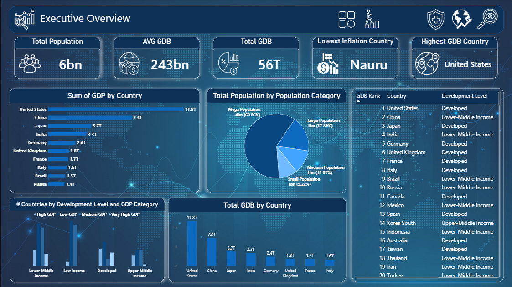
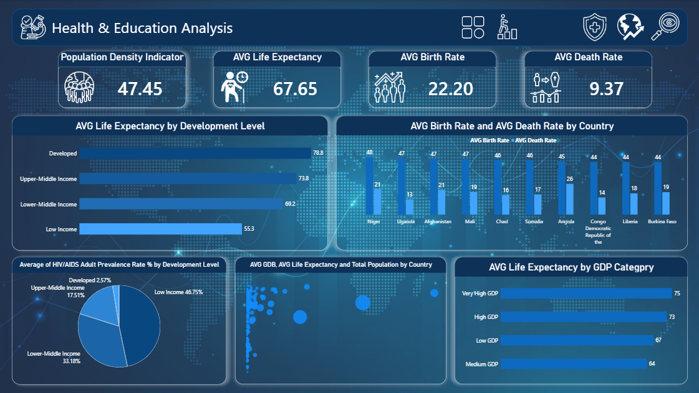
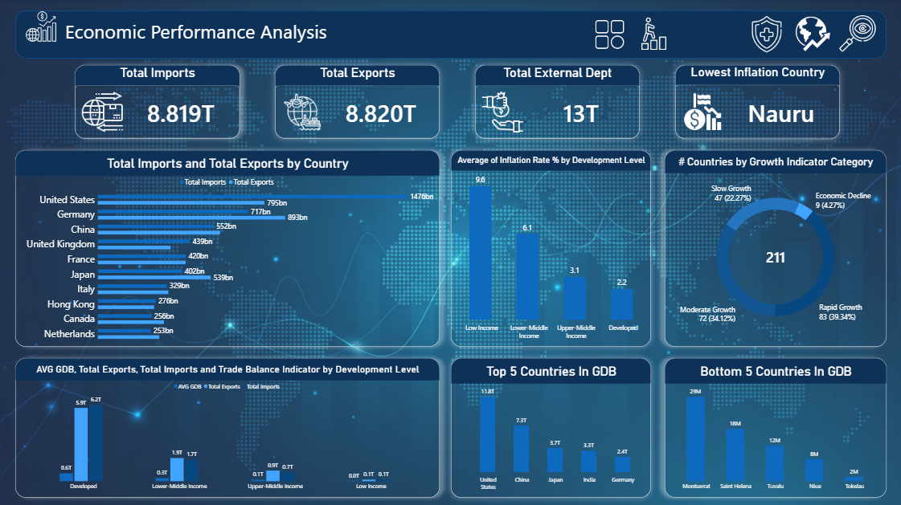

# 🌍 Global Socio-Economic & Country Comparison Dashboard

An interactive multi-page **Power BI** dashboard analyzing global socio-economic indicators, public health & education metrics, and international economic performance across nations.

---

## 📌 Executive Dashboard Visuals

### 1️⃣ Executive Overview

### 2️⃣ Health & Education Analysis

### 3️⃣ Economic Performance Analysis

---

## 📊 Key Analytical Insights

### 1. Executive Overview
* **Global Scale:** Analyzes global population metrics (~6 Billion), total world GDP ($56 Trillion), and average country GDP ($243 Billion).
* **Economic Distribution:** Highlights top-tier economies (USA, China, Japan, Germany) and categorizes global nations into development tiers.
* **Country Rankings:** Interactive dynamic table ranking countries by GDP and income levels.

### 2. Health & Education Analysis
* **Life Expectancy Trends:** Demonstrates a high correlation between development status and average life expectancy (Developed: ~78.8 years vs. Low Income: ~55.3 years).
* **Demographic Rates:** Evaluates birth vs. death rates across developing nations (e.g., Niger, Uganda, Afghanistan).
* **Health Challenges:** Highlights HIV/AIDS adult prevalence distribution, with 46.75% concentrated in low-income regions.

### 3. Economic Performance Analysis
* **Trade Balance:** Evaluates global import ($8.819T) and export ($8.820T) dynamics across major economic powerhouses.
* **Inflation Rates:** Assesses economic stability, showing low-income nations averaging ~9.6% inflation.
* **Growth Indicators:** Categorizes 211 nations across growth buckets (Rapid Growth, Moderate Growth, Slow Growth, and Economic Decline).

---

## 🛠️ Tools & Skills Applied
* **Power BI Desktop:** Multi-page dashboard architecture, data modeling, interactivity, and design formatting.
* **DAX (Data Analysis Expressions):** Calculated indicators and summary aggregations.
* **Data Transformation:** Data cleaning and structured data categorization via Power Query / Excel.

---

## 📄 Documentation Reports
* **Business Insights Report:** Detailed analysis document (`Business Insights Report - Global Socio-Economic.pdf`).
* **DAX Formulas Documentation:** Complete measure formulas (`DAX Documentation - Power BI Dashboard.pdf`).

---

## 👤 Author
* **Amr Ramadan** - Data Analyst & Computer Engineering Student
